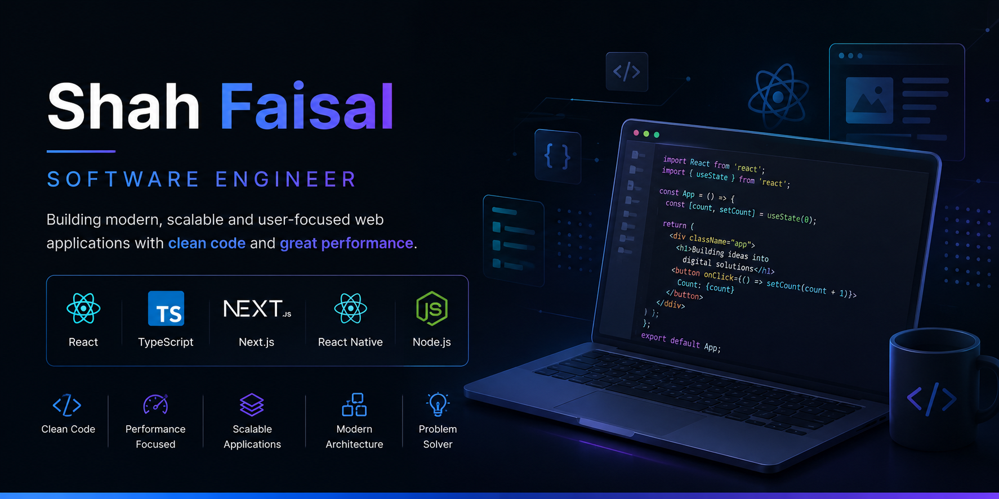

# 👋 Hi, I'm Shah Faisal Ahmad

\<h3 align="center">
&#x20; Software Engineer | React.js | Next.js | TypeScript | Node.js | C# / .NET
\</h3>

\

&#x20; \
\

\

&#x20; Software Engineer with 4+ years of experience building scalable, high-performance web applications and enterprise SaaS products. Passionate about frontend architecture, clean code, reusable components, and delivering exceptional user experiences.
\

\

&#x20; \<a href="[https://www.linkedin.com/in/shah-faisal-ba4a71212/](https://www.linkedin.com/in/shah-faisal-ba4a71212/)">
&#x20;   \
&#x20; \</a>
&#x20; \<a href="[https://shahfaisalahmad.netlify.app/](https://shahfaisalahmad.netlify.app/)">
&#x20;   \
&#x20; \</a>
&#x20; \<a href="mailto\:shahf6738\@gmail.com">
&#x20;   \
&#x20; \</a>
\

---

## 👨‍💻 About Me

- 💼 4+ years of professional software development experience.
- ⚛️ Specialized in React.js, Next.js, TypeScript, and modern frontend architecture.
- 🏢 Experienced in building enterprise SaaS applications and production-grade dashboards.
- 🚀 Full-stack development experience with Node.js, Express.js, C#, and ASP.NET Core.
- 📊 Experienced in building data-intensive dashboards, advanced tables, and interactive visualizations.
- 🔐 Experienced in authentication, JWT, OAuth 2.0, and Role-Based Access Control (RBAC).
- ⚡ Focused on performance optimization, Core Web Vitals, and reusable component libraries.
- 🤖 Exploring AI-assisted development with Claude Code, Codex, GitHub Copilot, and Cursor.

---

## 🛠️ Technical Skills

### 🎨 Frontend Development

\

### ⚙️ Backend Development

\

### 🗄️ Databases & Authentication

\

### 📊 Data Visualization

- AmCharts
- Elastic Charts
- Recharts
- D3 Visualizations
- Interactive Dashboards
- Advanced Data Tables

### 🧪 Testing & Performance

- Cypress E2E Testing
- React Profiler
- Code Splitting & Lazy Loading
- Server-Side Rendering (SSR)
- Static Site Generation (SSG)
- Core Web Vitals
- Web Accessibility (WCAG / ARIA)

### 🔧 Tools & Platforms

\

### 🤖 AI-Powered Development

- Claude Code
- OpenAI Codex
- GitHub Copilot
- Cursor
- Prompt Engineering

### 📋 Methodologies

- Agile / Scrum
- Clean Architecture
- Component-Based Architecture
- Responsive Design
- Code Reviews

---

## 💼 Professional Experience

### 🚀 Software Engineer | Horizon Dream Vision

**September 2026 – Present**

`React.js` `JavaScript` `C#` `.NET` `REST APIs` `SQL Server`

- Developing and maintaining the BusTracker application using React.js and JavaScript.
- Building responsive interfaces for live trip monitoring, bus locations, and route reports.
- Integrating frontend applications with REST APIs and backend services built with C# and .NET.
- Implementing data-driven tables with search, sorting, pagination, and auto-refresh functionality.
- Troubleshooting frontend-backend integration issues and optimizing data rendering.

### ⚡ Software Engineer | Ematrix Solutions

**January 2026 – September 2026**

`Next.js` `TypeScript` `Redux` `Node.js` `Express.js`

- Built and maintained backend APIs for an order aggregator platform, integrating 100+ external service providers into a unified interface.
- Designed and implemented Role-Based Access Control (RBAC) middleware for authentication and authorization across 1,000+ client applications.
- Developed permission-aware dashboards using Next.js and TypeScript.
- Automated pending-order status updates, reducing manual effort from 3 minutes per order to processing 50 orders per second.
- Developed responsive frontend interfaces and managed application state using Redux.

### 🌐 Software Engineer | Everlytics Data Science Pte Ltd

**August 2022 – January 2026**

`React.js` `Next.js` `TypeScript` `Redux Toolkit` `GraphQL` `Material UI` `Elastic UI` `Cypress`

- Developed and maintained accessible, high-performance web applications for an AI-powered enterprise SaaS platform.
- Built reusable UI component libraries using Elastic UI (EUI), React Hooks, and modern design patterns.
- Developed data-intensive interfaces for the 4Pointx enterprise SaaS product, including advanced tables, filtering, pagination, expandable rows, and D3 visualizations.
- Integrated REST APIs and GraphQL endpoints with JWT authentication, token refresh, protected routes, and Axios interceptors.
- Managed complex application state using Redux Toolkit and Context API.
- Improved Core Web Vitals through virtualization, memoization, code splitting, lazy loading, and SSR/SSG.
- Contributed to code reviews, debugging, production support, Cypress E2E testing, and team mentoring.

---

## 🚀 Featured Projects

### 🏥 Healthcare App

**React.js | TypeScript | Redux Toolkit | Firebase | REST APIs**

Healthcare analytics dashboard featuring data visualization, application state management, and reusable UI components.

🔗 [View Repository](https://github.com/shahf6738/healthcare-app)

---

### 🖼️ Gallery Web App

**React.js | TypeScript**

Responsive image gallery application featuring:

- Image browsing and searching
- Sorting and selection
- Image downloading
- Modern responsive UI

🔗 [View Repository](https://github.com/shahf6738/gallery-web-app)

---

### 📇 Contact Management App

**React.js | TypeScript**

Contact management application with complete CRUD functionality:

- Create and manage contacts
- Search and filter contacts
- Edit existing records
- Delete contacts

🔗 [View Repository](https://github.com/shahf6738/contact-management-app)

---

## 📈 GitHub Statistics

\

&#x20; \
&#x20; \
\

\

&#x20; \
\

---

## 🎓 Education

**Bachelor of Engineering (B.E.) – Computer Engineering**

University of Kashmir | 2022

---

## 🏆 Certifications

- Frontend Developer (React) — HackerRank
- Software Engineer — HackerRank
- REST API & Node.js — HackerRank
- JavaScript Algorithms and Data Structures — freeCodeCamp
- Responsive Web Design — freeCodeCamp

---

## 📫 Connect With Me

\
   \<a href="[https://www.linkedin.com/in/shah-faisal-ba4a71212/](https://www.linkedin.com/in/shah-faisal-ba4a71212/)">     \   \</a>   \<a href="mailto\:shahf6738\@gmail.com">     \   \</a>   \<a href="[https://shahfaisalahmad.netlify.app/](https://shahfaisalahmad.netlify.app/)">     \   \</a> \

📍 Srinagar, Jammu & Kashmir, India

---

\
   ⭐ Thanks for visiting my profile!   \    💻 Keep Building. Keep Learning. Keep Growing. \

